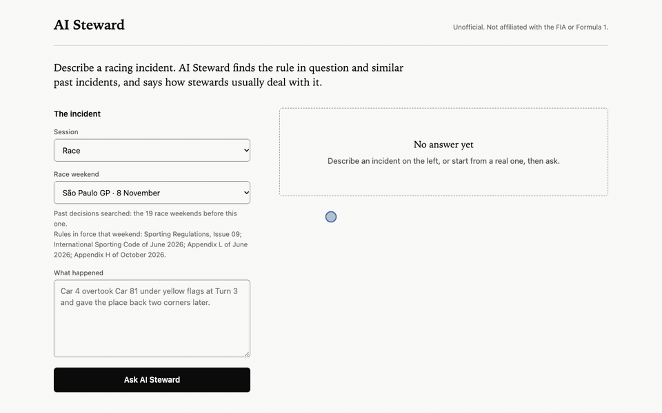
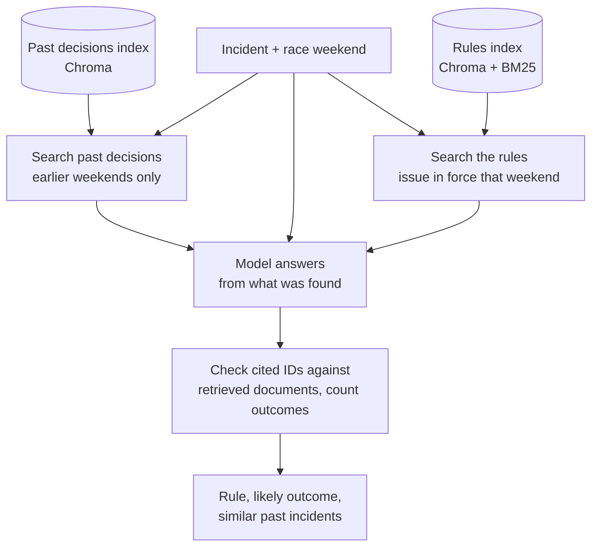

<!--
DRAFT for the public repository's README. Nothing here has been measured yet.
Cells marked TBD get filled from results/summary.json after the evaluation run.
Do not put FIA document text or PDFs in the repository (see "Documents"). The one exception is
docs/demo.gif, which includes the stewards' decision and its page image (user decision, 2026-11-15).
docs/demo.gif is recorded from the running app after the product screen is built. Until then
mockup-readme-demo.gif is a stand-in recorded from mockup-v4.html.
-->

# AI Steward

A local RAG app for Formula 1 racing incidents. Describe an incident and AI Steward finds the rule in question, the usual penalty, and similar incidents from earlier race weekends with what the stewards actually decided. For real incidents it shows the stewards' own decision next to its answer.



Unofficial. Not affiliated with the FIA or Formula 1.

## What it does

1. You describe an incident, or pick a real one from the 2026 season.
2. AI Steward searches earlier stewards' decisions and the regulation documents it holds, in the version in force that weekend, and answers from what it found.
3. For a real incident, the stewards' actual decision appears right under the answer, with the original document.

It works from text only. It has no video, telemetry or hearing, so it gives the usual outcome and the stewards may decide otherwise.

## Why retrieval

The penalty for a racing incident is a judgment call. The rules say what is forbidden; how past incidents were decided says what usually happens next. There are 359 decisions from the 2026 season so far and about 18 more every race weekend, so the model is given the few that matter instead of all of them.

When it answers about a race weekend, it can only see decisions from earlier weekends. It never sees the decision it is being compared with, or any other decision from the same weekend.

## How it works



Both indexes are built on your machine from documents downloaded from fia.com, and rebuilt after each race weekend.

- One decision is one chunk. One article is one chunk, with its heading path in front.
- Past decisions are searched by meaning, with embeddings. Keyword search (BM25) and a hybrid of the two (reciprocal rank fusion) were built and measured as well; the hybrid did not beat embeddings alone, so the simpler method is used. The numbers are under "Which search method" below. The method for searching the rules: TBD, chosen the same way.
- After the model answers, code checks that every rule and decision it cites was actually retrieved. This catches invented citations. It does not check that the reasoning follows from them.
- The counts shown with an answer ("5 of 8 similar incidents got 10 seconds") are computed in code, not written by the model. They summarize a wider set of retrieved earlier decisions under the predicted rule. They describe those examples and are not outcome probabilities.

## How well it works

All numbers are from race weekends the system was not tuned on, except the one table that says otherwise. Scoring is rule-based against the stewards' decisions; no model grades another model. Scores measure agreement with the article and penalty in the stewards' document. They do not assess whether the explanation follows from its sources.

### Does search recover decisions under the same rule?

| Measure | BM25 only | Embeddings only (used) | Hybrid |
|---|---|---|---|
| A decision under the same rule is in the top 5 | TBD | TBD | TBD |
| Share of the top 5 that are under the same rule | TBD | TBD | TBD |
| The right article is in the top 8 rules | TBD | TBD | TBD |

"Same rule" is a stand-in for "similar incident". Two incidents under the same rule can still be different situations.

### Which search method?

The method was chosen on the six tuning weekends (Monaco to Hungarian), not on the weekends reported above. Each of 94 decisions was asked as a question in other words than the stewards used, and searched for among the decisions of earlier weekends.

| Method | A decision under the same rule is in the top 5 | Share of the top 5 under the same rule |
|---|---|---|
| BM25 only | 66 of 94 | 0.357 |
| Embeddings only | 70 of 94 | 0.479 |
| Hybrid, equal weights | 69 of 94 | 0.447 |
| Hybrid, best of 18 settings | 71 of 94 | 0.474 |

Embeddings beat keyword search clearly. The hybrid got better only as it leaned further towards embeddings, and its best setting is level with embeddings alone: one question either way. With the stewards' own wording as the question all three were level (65 to 67 of 87). The reworded questions were written by a model and stay close to the originals, so this is a mild test of wording, not a test on real users' questions.

TBD of TBD questions cite an article outside the regulation documents included. They stay in the scores.

### What does search add to the answer?

The same questions, answered three ways. Only what the model is given differs.

| The model is given | Rule right | Cited articles right | Outcome right | Both right | Failed calls | Cost per question |
|---|---|---|---|---|---|---|
| Nothing (answers from memory) | TBD | TBD | TBD | TBD | TBD | TBD |
| Retrieved rules | TBD | TBD | TBD | TBD | TBD | TBD |
| Retrieved rules and past decisions | TBD | TBD | TBD | TBD | TBD | TBD |

Model: `gpt-6.1-terra`. TBD questions from TBD race weekends.

Differences between rows are paired differences on the same questions, with bootstrap confidence intervals (TBD). Failed calls are timeouts, rate limits and truncated answers. They are counted here and not scored as wrong.

Results are also split by kind of incident (TBD table): judgment calls, procedural and technical breaches, power unit parts, pit lane speeding. Outcomes fixed by the rules are reported separately from outcomes the stewards choose.

## How it was measured

**Questions.** Each real decision is one question: the session and the stewards' one-line statement of fact. As of 14 November 2026 the FIA had published 488 decisions over 20 race weekends; 129 are lap-time deletion lists, leaving 359.

**Answers.** The rule and the penalty in the same document.

**What counts as right.**
- Rule right: at least one cited article equals an article the stewards cited, at article-number level. An article and its sub-article count as the same (`8.2.2` and `8.2.2.a`).
- Cited articles right: of the articles an answer cites, the share the stewards also cited. This catches answers that list many articles to hit one.
- Outcome right: same penalty type, same value and unit. Penalty points are not scored. Where the stewards choose the penalty, a different answer is not necessarily an indefensible one.

**Split by time.** Early race weekends are search material only. Middle weekends were used while building. The reported numbers come from later weekends.

**Checks on the evaluation itself.**
- Gold labels fed back through the scorer score 100%. This checks the scorer, not the labels.
- 30 parsed decisions are compared by hand with the original documents.
- An empty answer and a most-common-answer baseline are reported next to the results.
- No question ever retrieves its own decision or one from the same weekend. This is tested for every question.
- With search switched off, the system falls to the no-search score.
- Question text is scanned for leaked article numbers and penalties.
- `gpt-6.1-terra` has a training cutoff of 1 June 2026. The reported weekends are after that date.

**Limits.**
- One sport, one season, 359 decisions.
- The part of a penalty the stewards choose cannot be predicted from text. Past decisions narrow the range; they do not settle it.
- Questions are one-line facts, shorter and more formulaic than what a person would type.
- Agreement with the stewards' article and penalty is not the same as a sound explanation. Explanation quality is not measured.
- Regulation documents included: TBD. Decisions that cite articles outside them are counted and reported, not removed.

## Run it

Requires Python 3.12 and [uv](https://docs.astral.sh/uv/). Put your OpenAI API key in a `.env` file:

```bash
OPENAI_API_KEY=your-key
```

```bash
uv sync
uv run f1aisteward fetch     # download rules and decisions from fia.com
uv run f1aisteward build     # parse, label and index them locally
uv run f1aisteward serve     # the app, at http://localhost:8000
```

To reproduce the numbers above:

```bash
uv run f1aisteward eval      # the search and answer evaluations
```

The full evaluation costs about TBD at November 2026 prices and takes about TBD.

## Documents

Rule and decision documents belong to the FIA. Apart from the demo above, which shows one decision as it appears in the app, this repository contains no PDFs and no document text. It holds links, labels (article, penalty type, value) and a hash of each source. Everything else is rebuilt on your machine from your own downloads, and the app runs locally for the same reason.

## Stack

| Part | Built with | What it does here |
|---|---|---|
| Search | LangChain retrievers, Chroma, `text-embedding-3-large`; BM25 and rank fusion for the comparison | Vector search over past decisions; search over the rules |
| Answer | LangChain `ChatOpenAI`, Pydantic | One shared path for answer-generation calls, structured output |
| Model | OpenAI `gpt-6.1-terra` | `gpt-6-luna` while building |
| Evaluation | Own runner, rule-based scoring, pytest | Search and answer scores in `results/summary.json` |
| Tracing | LangSmith | Reading each call during development |
| App | FastAPI, one static HTML page | Runs locally |
| Packaging | Python 3.12, uv | A few commands from clone to results |
