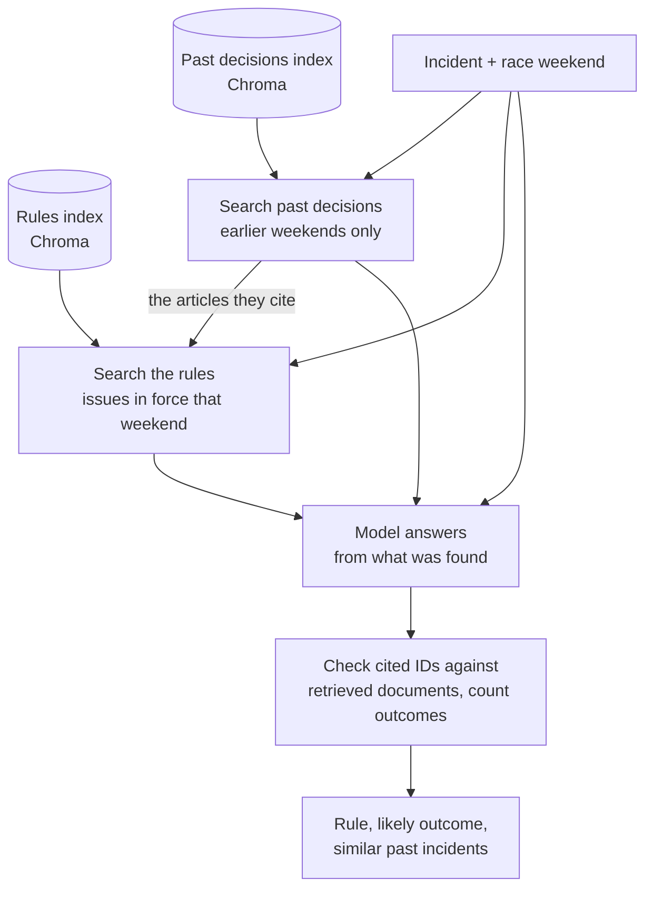

# AI Steward

A local RAG app for Formula 1 racing incidents. Describe an incident and AI Steward finds the rule in question, the usual penalty, and similar incidents from earlier race weekends with what the stewards actually decided. For a real incident it shows the stewards' own decision next to its answer.


Unofficial. Not affiliated with the FIA or Formula 1.

## What it does

1. You describe an incident, or pick a real one from the 2026 season.
2. AI Steward searches earlier stewards' decisions and the regulations in force that weekend, and a model answers from what was found: the rule, the likely penalty and why.
3. For a real incident, the stewards' actual decision appears under the answer, with the original document. The answer is made without it.

It works from text only. It has no video, telemetry or hearing, so it gives the usual outcome and the stewards may decide otherwise. In the demo they did: the contact was minor and the track was wet, and the stewards' reason says so.

## Why retrieval

The penalty for a racing incident is a judgment call. The rules say what is forbidden; how earlier incidents were decided says what usually happens. The 2026 season has 359 decisions so far and about 18 more every race weekend, so the model is given the few that matter instead of all of them.

The model's own memory is not enough, and looks out of date: asked with nothing retrieved, it cites "Article 34.7 of the FIA Formula One Sporting Regulations" for pit lane speeding. The 2026 rules have no such article; they moved the sporting rules into Section B, where pit lane speeding is B1.6.3. The numbers it uses are most likely those of earlier seasons.

When it answers about a race weekend it only sees decisions from earlier weekends, never the decision it is compared with or any other decision of the same weekend.

## How it works



Both indexes are built on your machine from documents downloaded from fia.com, and rebuilt after each race weekend.

Each step, what it does and why. "Measured" means compared on the six tuning weekends or on the test weekends; "checked" means verified on every question; "by design" means the reason is a rule of the product rather than a measurement.

| Step | What it does | Why | Based on |
|---|---|---|---|
| Chunks | One decision is one chunk. One article of the rules is one chunk, with its heading path in front; its points a) to e) stay inside it | A decision's statement of fact is short (12 words at the median), and the stewards cite rules by article | Checked: every article the stewards cite from the four rule books is found in the issue in force |
| What is embedded | The session and the statement of fact. Not the stewards' reason; the article and the penalty go in metadata only | The reason states the decision, penalty included, so searching it would find the answer rather than similar incidents. A question has the same shape: session and what happened | By design |
| Search method | Embeddings. Keyword search (BM25) and a hybrid of the two (reciprocal rank fusion) are built as well | On a tie the simpler method is used: the best of 18 hybrid settings found a decision under the same rule for 72 of 94 reworded questions, embeddings alone for 71 | Measured, tuning weekends |
| What may be found | Decisions of earlier weekends only, and articles of the rule issues in force that weekend | The stewards could not read later decisions, and the evaluation must never find its own answer. Five issues of the Sporting Regulations were in force during the season | Checked on every search: no exception |
| Rules reached through decisions | The articles cited by the 5 decisions found are added to the 8 rules found by search | Search alone missed the general articles the stewards cite most, such as the one on causing a collision; every decision names its articles | Measured: share of the stewards' articles given to the model 0.61 → 0.94 on the test weekends. 14 rules from search alone reached 0.76 on the tuning weekends |
| After the answer | The model answers in a fixed structure (articles, penalty, reason, decisions relied on). Code checks that every article and decision it cites was retrieved, and counts how earlier decisions under its rule ended ("10 of 19 ended with no further action") | A model can invent a citation or miscount. The check does not test whether the reasoning follows from the sources, and the counts describe those examples; they are not probabilities | Checked: every test answer that was shown documents passed

## How well it works

Every number below comes from the 9 race weekends from the Dutch to the São Paulo Grand Prix, which were never used for tuning: 144 incidents, each asked in the stewards' own one-line statement of fact. Scoring is rule-based against the stewards' decisions; no model grades another model. It measures agreement with the article and the penalty in the stewards' document, not whether the explanation is sound.

### What does search add to the answer?

The same incidents, answered three ways with `gpt-6.1-terra`. Only what the model is given differs; the instructions are the same.

| The model is given | Rule right | Cited articles right | Outcome right | Both right | Cost per question |
|---|---|---|---|---|---|
| Nothing (answers from memory) | 22% | 22% | 46% | 11% | $0.0031 |
| Retrieved rules | 65% | 51% | 51% | 35% | $0.0037 |
| **Retrieved rules and past decisions** (the app) | **87%** | **78%** | **65%** | **57%** | $0.0043 |
| *No model:* the most common article and penalty so far | 22% | 22% | 20% | 6% | $0 |
| *No model:* the majority of the 5 past decisions found | 75% | 75% | 36% | 28% | $0 |

No call failed (no timeouts, rate limits or cut-off answers). Every citation in the two configurations that were shown documents passed the citation check.

Each step is a paired difference on the same 144 incidents, with a 95% bootstrap interval:

| | Rule right | Outcome right | Both right |
|---|---|---|---|
| Rules, over nothing | +43 points (+31 to +55) | +5 points (−4 to +14) | +24 points (+15 to +34) |
| **Past decisions, over rules alone** | +22 points (+14 to +29) | +15 points (+6 to +24) | **+22 points (+13 to +30)** |

- The rules mostly fix the article. The past decisions fix the penalty as well: the outcome only moves once the model sees how the stewards decided before.
- Voting among the 5 decisions found, with no model, gets the article right 75% of the time and the penalty 36%. The model reading the same decisions gets 87% and 65%: it does more than pick the most common outcome.

<details>
<summary>The same table with the smaller <code>gpt-6-luna</code> (about a seventh of the cost)</summary>

| The model is given | Rule right | Cited articles right | Outcome right | Both right | Cost per question |
|---|---|---|---|---|---|
| Nothing (answers from memory) | 24% | 23% | 47% | 11% | $0.0005 |
| Retrieved rules | 62% | 51% | 43% | 29% | $0.0005 |
| Retrieved rules and past decisions | 88% | 73% | 57% | 49% | $0.0006 |

On the same incidents `gpt-6.1-terra` is level on the rule (−1 point, −4 to +2) and ahead on the outcome (+8 points, +3 to +15), mostly on power unit penalties, where the number of grid places has to be worked out from the parts listed: terra got all 28 right, luna 19. The app uses `gpt-6.1-terra`.

</details>

### By kind of incident

`gpt-6.1-terra`, retrieved rules and past decisions. The overall score depends on the mix, so it is split by kind.

| Kind of incident | Incidents | Rule right | Outcome right | Both right |
|---|---|---|---|---|
| Judgment calls (collisions, track limits, impeding, flags) | 59 | 88% | 53% | 47% |
| Procedural and technical | 47 | 74% | 57% | 38% |
| Power unit parts (penalty set by a table) | 28 | 100% | 100% | 100% |
| Pit lane speeding (penalty set by a table) | 10 | 100% | 80% | 80% |

Where a table in the rules sets the penalty, 36 of 38 are fully right. Where the stewards choose, 43% are. The difference between 5 seconds and 10, or a reprimand and a warning, can rest on details the one-line statement leaves out, as in the demo, where the stewards' reason cites the wet track and the minor contact.

### Does search find decisions under the same rule?

Each incident is searched among the decisions of earlier weekends. "Same rule" stands in for "similar incident"; two incidents under the same rule can still be different situations.

| On the 9 test weekends | BM25 | Embeddings (used) | Hybrid |
|---|---|---|---|
| A decision under the same rule in the top 5, stewards' wording (144) | 0.81 | 0.82 | 0.85 |
| The same, reworded questions (153) | 0.78 | 0.84 | 0.84 |
| Share of the top 5 under the same rule, reworded | 0.48 | 0.57 | 0.56 |
| Share of the stewards' articles among the 8 rules found, reworded | 0.42 | 0.50 | 0.50 |
| The same, with the articles cited by the decisions found added | | **0.95** (9.5 rules on average) | |

For 8 of the 144 incidents no earlier decision was under the same rule, so the best possible top-5 score is 0.94. One of the 206 articles the stewards cited is in a rule book that is not included (Section C, technical); it stays in the scores.

The reworded questions are the same incidents in other words, written for this project, to test wording a user might type. On the test weekends the hybrid is ahead by 4 incidents on the stewards' wording and behind on the reworded questions; the method was chosen earlier, on the tuning weekends:

<details>
<summary>How the search method was chosen (the six tuning weekends, Monaco to Hungarian)</summary>

Each of 94 decisions was asked as a question in other words than the stewards used, and searched for among the decisions of earlier weekends.

| Method | A decision under the same rule in the top 5 | Share of the top 5 under the same rule |
|---|---|---|
| BM25 only | 67 of 94 | 0.360 |
| Embeddings only | 71 of 94 | 0.483 |
| Hybrid, equal weights | 70 of 94 | 0.451 |
| Hybrid, best of 18 settings | 72 of 94 | 0.479 |

Embeddings beat keyword search clearly. The hybrid got better only as it leaned towards embeddings, and its best setting is level with embeddings alone. With the stewards' own wording all three were level (66 to 68 of 87).

The same questions asked of the rules in force that weekend (recall: the share of the articles the stewards cited that are among the rules found):

| Method | Rules given to the model | Recall |
|---|---|---|
| BM25 only | 8 | 0.518 |
| Embeddings only | 8 | 0.644 |
| Hybrid, equal weights | 8 | 0.635 |
| Embeddings only, more rules | 14 | 0.702 |
| Embeddings, plus the articles the decisions found cite (used) | 9.7 on average | 0.924 |

Returning more rules from search alone does not do what the decisions do. For "Car 27 ran into car 55 at turn 8 in the race." the article on collisions is not among the 14 closest rules, while all five decisions found were decided under it.

</details>

### What the evaluation caught

- **The baseline was broken by the prompt, not the model.** With one instruction for all three configurations ("cite only articles given here"), the model given nothing cited nothing, and scored 0% on the rule by construction. The instruction was fixed on the tuning weekends; only then did the no-search row measure memory.
- **The model's memory of the rules looks out of date.** Answering from memory it cited "34.7" for pit lane speeding and "33.3" for leaving the track, numbers that do not exist in the 2026 rules (B1.6.3 and B1.8.6 there), most likely those of earlier seasons. All its right answers were articles of the International Sporting Code, none of Section B.
- **The citation check caught a prompt regression.** A wording change made the model copy the square brackets around ids ("[F1-B:4.1.1]"), and the share of answers passing the check fell to 20 to 30%. Each run now records a fingerprint of its prompt.
- **Power unit penalties are arithmetic.** The smaller model often copied the number of grid places from a similar decision instead of counting the parts in the incident. Moving that count into code is the obvious next step.

## How it was measured

**Questions.** One decision is one question: the session and the stewards' one-line statement of fact (for example "Race. Car 7 made contact with Car 8 at turn 3.", made up here). Several decisions about one incident, one per car, are one question that accepts any of their penalties. Decisions whose statement only points at a table of cars, or names an article, are left out (8 of 160 on the test weekends).

**Answers.** The articles and the penalty in the same document, parsed from the 2026 decision PDFs. 30 parsed decisions were compared by hand with the original documents: none was wrong.

**What counts as right.**
- Rule right: at least one cited article is one the stewards cited, at article-number level. An article and its points count as the same (`IV.2` and `IV.2.d`); a broader number does not (`B1.8` is not `B1.8.5`).
- Cited articles right: of the articles an answer cites, the share the stewards also cited. This catches answers that list many articles to hit one.
- Outcome right: the same penalty type, value and unit (5 seconds, 3 grid places, €5,000). Penalty points are not scored.

**Split by time.** Weekends before 1 June 2026 are search material only (the training cutoff of `gpt-6.1-terra`). Monaco to Hungarian were used for tuning: the search method, the prompt and the reasoning effort (low, medium and high were level, so medium stayed). Dutch to São Paulo produce the numbers above and were used for nothing else.

**Checks on the evaluation itself**, recomputed from the records by `eval --report`:
- The stewards' own labels, fed through the scorer as answers, score 100%; an empty answer scores 0%.
- No question was shown a decision from its own or a later weekend, and every rule shown is from the issue in force that weekend.
- With search switched off, every configuration sends exactly the no-search prompt (a test).
- Question texts are scanned for article numbers and penalty phrases.
- Failed calls would be counted and not scored as wrong; there were none.

**Limits.**
- One sport, one season, 359 decisions.
- The part of a penalty the stewards choose cannot be predicted from one line of text. Past decisions narrow the range; they do not settle it.
- Questions are the stewards' one-line facts, shorter and more formulaic than what a person would type.
- Agreement with the stewards' article and penalty is not the same as a sound explanation. Explanation quality is not measured.
- Regulation documents included: Section B (sporting) of the F1 Regulations, the International Sporting Code and its Appendices L and H, in each of the 11 issues in force at some point of the season.

## Run it

Requires Python 3.12, [uv](https://docs.astral.sh/uv/) and an OpenAI API key. Put the key in a `.env` file in the project folder:

```bash
OPENAI_API_KEY=your-key
```

Then download the documents from fia.com, build the indexes and start the app:

```bash
uv sync
uv run f1aisteward fetch --rules                     # the 11 rule document issues
uv run f1aisteward fetch                             # the 2026 decisions
uv run f1aisteward build --decisions --rules --index # parse, label and embed them (about $0.10)
uv run f1aisteward serve                             # the app, at http://localhost:8000
```

fia.com sometimes answers "too many requests" after about a hundred files; `fetch` then stops and says so, and running it again later continues where it stopped. Every downloaded file is checked against the hash in `data/manifest/`. Each answer in the app costs about $0.004.

From the command line:

```bash
uv run f1aisteward ask "Car 4 overtook Car 81 under double yellow flags at Turn 3." --event sao-paulo
uv run f1aisteward search "car 7 pushed car 8 off the track at turn 4" --event sao-paulo
```

### Reproduce the numbers

The answers behind every table are in `runs/` (ids, labels, tokens and cost; no document text), so the tables can be recomputed without an API key:

```bash
uv run f1aisteward eval --report --run test-gpt-6.1-terra-medium --run test-gpt-6-luna-medium
```

To run the evaluation again from scratch (about $1.60 and 10 minutes for `gpt-6.1-terra`, $0.23 for `gpt-6-luna`, at November 2026 prices):

```bash
uv run f1aisteward eval --retrieval --split test
uv run f1aisteward eval --answers --split test --model gpt-6.1-terra --run my-run
uv run f1aisteward eval --report --run my-run
uv run pytest -q
```

The 325 tests take a few seconds, use made-up documents and never touch the network.

## Project layout

| Path | What it is |
|---|---|
| `src/f1aisteward/fetch.py`, `manifest.py` | Download decisions and rules from fia.com, check their hashes |
| `src/f1aisteward/parse/` | Decision PDF → fields and labels; rule PDF → articles |
| `src/f1aisteward/index.py`, `search.py` | Chroma and BM25 indexes; search over earlier weekends and the issues in force |
| `src/f1aisteward/answer.py`, `llm/client.py` | The prompt, the structured answer, the citation check, the outcome counts |
| `src/f1aisteward/eval/` | Search evaluation, the answer evaluation runner, scoring, the report |
| `src/f1aisteward/app/` | FastAPI server and the one-page app |
| `data/` | Links, hashes and labels of every document; no document text |
| `runs/`, `results/` | The recorded answers and the numbers computed from them |

## Documents

Rule and decision documents belong to the FIA. Apart from the demo above, which shows one decision as it appears in the app, this repository contains no PDFs and no document text. It holds links, labels (article, penalty type, value) and a hash of each source. Everything else is rebuilt on your machine from your own downloads, and the app serves only your own machine (127.0.0.1) for the same reason.

## Stack

| Part | Built with | What it does here |
|---|---|---|
| Search | LangChain retrievers, Chroma, OpenAI `text-embedding-3-large`; BM25 and rank fusion for the comparison | Vector search over past decisions and over the rules; the rules also get the articles those decisions cite |
| Answer | LangChain `ChatOpenAI`, Pydantic structured output | One path for every model call; token counts and cost recorded per call |
| Model | OpenAI `gpt-6.1-terra` | `gpt-6-luna` while building |
| Evaluation | Own runner and rule-based scorer, paired bootstrap, pytest | Resumable runs in `runs/`, numbers in `results/summary.json` |
| PDFs | pypdf, pdfplumber, pypdfium2 | Decision text; two-column rule documents cut to their English column; page images for the app |
| App | FastAPI, one static HTML page with plain JavaScript | Runs locally |
| Packaging | Python 3.12, uv, Typer | A few commands from clone to results |
